<!-- ─────────────────────────────  HERO  ───────────────────────────── -->
<a href="https://pedrodcarvalho.github.io">
  <picture>
    <source media="(prefers-color-scheme: dark)" srcset="assets/hero-dark.svg">
    
  </picture>
</a>

<div align="center">

<a href="https://pedrodcarvalho.github.io"></a>
<a href="https://www.linkedin.com/in/pedro-domitti-de-carvalho"></a>
<a href="mailto:pedrodc51203@gmail.com"></a>
<a href="https://pedrodcarvalho.github.io/cv/Pedro_Domitti_de_Carvalho_CV_EN.pdf"></a>

<a href="https://pedrodcarvalho.github.io">
  
</a>

</div>

> [!TIP]
> **Open to opportunities.** I graduate in **December 2026** and I'm looking for roles in **AI, embedded systems and software engineering**, in Brazil or abroad. The fastest way to reach me is [email](mailto:pedrodc51203@gmail.com).

## `00 · whoami`

I'm a **Computer Engineering** student at PUC-Campinas with **2 years of R&D** at [Instituto de Pesquisas Eldorado](https://www.eldorado.org.br/), one of Brazil's largest technology R&D institutes. I build **connected-vehicle (V2X) systems end to end**, from embedded C on vehicle and roadside units to computer vision and real-time dashboards. Now I'm focused on **bringing machine learning to embedded and edge systems**.

```c
/* pedro.h: compiled for the edge */
static const engineer_t pedro = {
    .name      = "Pedro Domitti de Carvalho",
    .role      = "Software Engineer Intern @ Eldorado · V2X Lab",
    .location  = "Campinas, SP, Brazil (UTC-3)",
    .focus     = { "TinyML", "Embedded Linux", "C-V2X", "Computer Vision" },
    .education = "B.Eng. Computer Engineering · PUC-Campinas · Dec 2026",
    .exchange  = "Vrije Universiteit Amsterdam · top 7.3% (47th / 650)",
    .languages = { PT_NATIVE, EN_FLUENT, ES_BASIC, DE_ELEMENTARY },
    .status    = OPEN_TO_WORK,
};
```

<picture>
  <source media="(prefers-color-scheme: dark)" srcset="assets/divider-dark.svg">
  
</picture>

<picture>
  <source media="(prefers-color-scheme: dark)" srcset="assets/v2x-system-dark.svg">
  
</picture>

**Software Engineer Intern · Instituto de Pesquisas Eldorado · Connected-vehicle (V2X) lab** · *Jan 2025 – present*

- 🚗 **CACC prototype for a global automaker**: real-time Cooperative Adaptive Cruise Control data exchange between two vehicles' on-board units, reaching **900+ m**. Demoed live to the automaker's senior executives.
- 🔌 **Embedded C/C++ on Linux C-V2X units**: speed and brake state from **CAN/OBD-II**, fused with **GNSS**, broadcast as **ETSI Cooperative Awareness Messages** tracking leader/follower state in real time.
- 🚦 **Roadside unit with computer vision**: Python RSU service that generates **SPaT/MAP** traffic-signal messages and runs **OpenCV + YOLO** pedestrian detection, groundwork for AI-driven traffic lights.

<details>
<summary><b>More from the lab:</b> test tooling, CI/CD, ROS 2 haptics</summary>
<br>

- 🧪 **The team's test tooling**: a **Flask + React/TypeScript** control dashboard, an **MQTT** traffic simulator mixing virtual and real vehicles, and **Linux netem** tooling that reproduces real-world latency and jitter on V2X links.
- 🔁 **Agile delivery & CI/CD**: Scrum sprints with Git/GitHub code review, **Docker**, CI/CD pipelines and **Bash** to cross-compile, deploy and test builds on OBUs and RSUs.
- 🦾 **ROS 2 haptic teleoperation**: ROS 2 nodes that teleoperate a **6-axis robotic arm** with a haptic device (force feedback, joint limits, smoothing), monitored via **Grafana/Zabbix**.

</details>

## `02 · selected work`

<p align="center">
  <a href="https://github.com/pedrodcarvalho/flora-sense"><picture>
    <source media="(prefers-color-scheme: dark)" srcset="assets/card-florasense-dark.svg">
    
  </picture></a>
  <a href="https://github.com/pedrodcarvalho/iottendance"><picture>
    <source media="(prefers-color-scheme: dark)" srcset="assets/card-iottendance-dark.svg">
    
  </picture></a>
  <a href="https://github.com/pedrodcarvalho/snake-game-rl"><picture>
    <source media="(prefers-color-scheme: dark)" srcset="assets/card-snake-ai-dark.svg">
    
  </picture></a>
  <a href="https://github.com/pedrodcarvalho/compiler-development"><picture>
    <source media="(prefers-color-scheme: dark)" srcset="assets/card-lpd-compiler-dark.svg">
    
  </picture></a>
</p>

<details>
<summary><b>More on GitHub:</b> kernel modules, CV experiments, a MIPS CPU in VHDL…</summary>
<br>

| Repository | What it is | Stack |
| :-- | :-- | :-- |
| [`cpu-profiler-linux-module`](https://github.com/pedrodcarvalho/cpu-profiler-linux-module) | A CPU profiler implemented as a Linux kernel module | `C` `Linux kernel` |
| [`single-cycle-mips-processor`](https://github.com/pedrodcarvalho/single-cycle-mips-processor) | Single-cycle MIPS processor for the Computer Architecture final project | `VHDL` |
| [`rock-paper-scissors-hand-detection-ai`](https://github.com/pedrodcarvalho/rock-paper-scissors-hand-deteciton-ai) | Rock-paper-scissors played with your hand, detected live in the browser | `TensorFlow.js` |
| [`computational-vision`](https://github.com/pedrodcarvalho/computational-vision) | Computer-vision experiments and models | `PyTorch` `Jupyter` |
| [`dijkstra-pathfinding-visualization`](https://github.com/pedrodcarvalho/dijkstra-pathfinding-visualization) | Dijkstra's shortest path on a real road network, as an animated plot | `Python` |
| [`btc-sentiment-scraping`](https://github.com/pedrodcarvalho/btc-sentiment-scraping) | Scrapes posts about Bitcoin and scores market sentiment with NLP | `Python` `NLP` |
| [`digital-systems`](https://github.com/pedrodcarvalho/digital-systems) | From logic gates to processors: boolean algebra, FSMs and VHDL | `VHDL` |
| [`mindshift`](https://github.com/pedrodcarvalho/mindshift) | A 2D puzzle-platformer built from scratch | `JavaScript` |

</details>

<picture>
  <source media="(prefers-color-scheme: dark)" srcset="assets/divider-dark.svg">
  
</picture>

## `03 · toolbox`

<table>
  <tr>
    <td width="150"><code>AI / ML</code></td>
    <td>
      <br>
      <sub>TensorFlow Lite Micro · YOLO · NumPy · pandas · CNNs · NLP · Reinforcement learning · LLM APIs (Gemini)</sub>
    </td>
  </tr>
  <tr>
    <td><code>EMBEDDED · V2X</code></td>
    <td>
      <br>
      <sub>Embedded Linux · Kernel modules · ESP32 · CAN/OBD-II · GNSS · MQTT · ROS 2 · C-V2X · ETSI ITS</sub>
    </td>
  </tr>
  <tr>
    <td><code>SOFTWARE</code></td>
    <td>
      <br>
      <sub>REST · WebSockets · SQL</sub>
    </td>
  </tr>
  <tr>
    <td><code>DEVOPS · TOOLS</code></td>
    <td>
      <br>
      <sub>CI/CD · Cross-compilation · Wireshark · Linux netem · Zabbix</sub>
    </td>
  </tr>
</table>

## `04 · telemetry`

<div align="center">
<picture>
  <source media="(prefers-color-scheme: dark)" srcset="generated/stats-dark.svg">
  
</picture>
<picture>
  <source media="(prefers-color-scheme: dark)" srcset="generated/languages-dark.svg">
  
</picture>
<picture>
  <source media="(prefers-color-scheme: dark)" srcset="generated/activity-dark.svg">
  
</picture>
<picture>
  <source media="(prefers-color-scheme: dark)" srcset="https://raw.githubusercontent.com/pedrodcarvalho/pedrodcarvalho/output/github-snake-dark.svg">
  
</picture>
</div>

## `05 · trajectory`

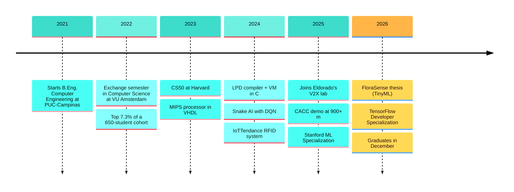

<details>
<summary><b>Education & certifications</b></summary>
<br>

| | Where | When |
| :-- | :-- | :-- |
| 🎓 **B.Eng. Computer Engineering** | PUC-Campinas · Campinas, Brazil | 2021 – Dec 2026 |
| 🇳🇱 **Exchange semester, Computer Science** | Vrije Universiteit Amsterdam · grade 8.3/10, **top 7.3%** (47th of 650) | Aug – Dec 2022 |

| Certification | Issuer | Year |
| :-- | :-- | :-- |
| TensorFlow Developer Specialization | DeepLearning.AI | 2026 |
| Google Prompting Essentials | Google | 2026 |
| Machine Learning Specialization | Stanford & DeepLearning.AI | 2025 |
| Generative AI Journey with IBM Granite | IBM SkillsBuild | 2025 |
| Writing, Running & Fixing Code in C | Duke University | 2025 |
| CS50: Introduction to Computer Science | Harvard University | 2023 |

</details>

## `06 · ping`

<div align="center">

**Let's build something that thinks.**<br>
<sub>Portuguese (native) · English (fluent) · Spanish (basic) · German (elementary)</sub>

<br>

<a href="mailto:pedrodc51203@gmail.com"></a>
<a href="https://pedrodcarvalho.github.io"></a>
<a href="https://pedrodcarvalho.github.io/pt/"></a>


</div>

<a href="https://pedrodcarvalho.github.io">
  <picture>
    <source media="(prefers-color-scheme: dark)" srcset="assets/footer-dark.svg">
    
  </picture>
</a>
